# 04 — تصميم قاعدة البيانات (ERD والقيود)

> المخطط التنفيذي المُتحقَّق منه: [`schema/schema.sql`](schema/schema.sql) (59 جدولاً، يعمل على PostgreSQL 16).
> الاختبارات التنفيذية للقيود: [`schema/tests/ledger_invariants.sql`](schema/tests/ledger_invariants.sql) — **29/29 ناجح**.
> هذا تصميم؛ ملفات الـ migrations الفعلية تُكتب في Phase 1 بعد الاعتماد.

## 1. ERD (مجالات)

```mermaid
erDiagram
  companies ||--o{ users : has
  companies ||--o{ partners : has
  users ||--o{ user_permissions : granted
  permissions ||--o{ user_permissions : in
  contacts ||--o{ purchase_orders : supplier
  contacts ||--o{ sales_invoices : customer
  products ||--o{ product_uoms : converts
  products ||--o{ stock_lots : layers
  stock_locations ||--o{ stock_lots : holds
  warehouses ||--o{ stock_locations : contains
  stock_lots ||--o{ stock_lot_consumptions : consumed_by
  purchase_orders ||--o{ purchase_lines : has
  purchase_orders ||--o{ purchase_receipts : received_by
  purchase_orders ||--o{ purchase_returns : returned_by
  purchase_orders ||--o{ supplier_payment_allocations : paid_by
  supplier_payments ||--o{ supplier_payment_allocations : applies
  sales_invoices ||--o{ sales_lines : has
  sales_invoices ||--o{ delivery_notes : delivered_by
  sales_invoices ||--o{ sales_returns : returned_by
  customer_receipts ||--o{ receipt_allocations : applies
  sales_invoices ||--o{ receipt_allocations : collected_by
  cash_accounts ||--o{ customer_receipts : received_into
  cash_accounts ||--o{ cash_movements : moves
  journal_entries ||--o{ journal_lines : has
  accounts ||--o{ journal_lines : posted_to
  profit_settlements ||--o{ profit_settlement_lines : releases
  profit_settlements ||--o{ profit_settlement_shares : splits
  profit_settlements ||--o{ profit_payouts : paid_by
  sales_invoices ||--o{ profit_settlement_lines : profit_from
  partners ||--o{ partner_ledger : statement
  partners ||--o{ capital_transactions : capital
  employees ||--o{ payroll_accruals : accrues
  payroll_accruals ||--o{ payroll_payments : settled_by
  expense_categories ||--o{ expenses : classifies
  sync_operations ||--o{ sync_conflicts : may_have
```

**كل مستند مرحّل** يحمل `journal_entry_id` يربطه بقيده. وكل حركة مخزون/نقد تشير إلى `doc_type/doc_id`.

## 2. القيود المحاسبية المفروضة في قاعدة البيانات (ليست في التطبيق فقط)

| القاعدة | الآلية | اختبار |
|---|---|---|
| قيد مزدوج متوازن (Σمدين = Σدائن، سطران على الأقل) | Constraint Trigger مؤجل عند COMMIT | J-1, J-2 |
| السطر إما مدين أو دائن | CHECK | J-3 |
| القيود والسطور لا تُعدّل ولا تُحذف | Trigger | J-4, J-5 |
| مستند مرحّل لا يُعدَّل؛ الانتقال الوحيد POSTED→REVERSED | Trigger `guard_document_lifecycle` | D-1, D-5 |
| الحذف للمسودات فقط | نفس الـ Trigger | D-2 |
| الرقم النهائي لا يوجد إلا لما رُحّل، وفريد | CHECK + Unique جزئي | D-3, D-4 |
| سطور مستند غير مسودة مقفلة | Trigger `guard_line_parent` | — (يُختبر في Phase 2) |
| لا رصيد سالب للطبقة | `CHECK (qty_remaining >= 0)` | F-4 |
| استهلاك أكبر من المتاح يفشل | منطق FIFO + قفل | F-3 |
| المال NUMERIC فقط | تعريف الأعمدة + قاعدة lint | — |
| لا cascade delete مالي | لا `ON DELETE CASCADE` في المخطط (فحص آلي في CI) | — |
| مصروف الشريك بمعالجة واحدة (لا تسجيل مكرر) | CHECK `payment_mode`/`partner_treatment` | E-1 |
| استحقاق راتب واحد لكل موظف/شهر | UNIQUE | E-2 |
| اعتماد رأس المال للمالك فقط، وليس مقدّم الطلب | Trigger + CHECK | C-1, C-2 |
| تمويل رأس المال للمالك وحده | Trigger | C-3 |
| لا منح ذاتي للصلاحيات | CHECK | C-4 |
| منع تكرار استخدام ربح الفاتورة | Trigger `release_continuity` | P-3 |
| منع تجاوز سقف الربح المرتبط بالتحصيل | CHECK | P-4 |
| منع تداخل فترات تسويات معتمدة | EXCLUDE gist | P-5 |
| الدفعات الجزئية ≤ الحصة، ومنع إعادة الدفعة | Trigger + UNIQUE(idempotency_key) | P-6, P-7, P-8 |
| مزامنة idempotent | UNIQUE(operation_id), UNIQUE(idempotency_key) | S-1 |
| عزل الشركة | RLS على كل جدول به `company_id` | Phase 1 (اختبار بدور تطبيق غير مالك) |

## 3. الفهارس الأساسية
- `stock_lots (product_id, location_id, received_at, id) WHERE qty_remaining > 0` — مسار FIFO.
- `journal_lines (account_id)` و`(contact_id)` — كشوف الحسابات والأعمار.
- `(company_id, doc_no) UNIQUE WHERE doc_no IS NOT NULL` لكل مستند.
- `stock_movements (company_id, product_id, location_id, moved_at)`، `cash_movements (cash_account_id, moved_at)`.
- `audit_logs (company_id, entity_type, entity_id, occurred_at)`.

## 4. ملاحظات تصميمية
1. **التزامن الإيجابي (optimistic)**: كل جدول قابل للتعديل فيه `version`؛ التحديث `WHERE id=? AND version=?` وإلا `409 VERSION_CONFLICT`.
2. **نوع المبالغ**: `NUMERIC(20,4)`؛ التقريب للعملة (IQD=0، USD=2) يحدث في طبقة الخدمة عند السطر ثم عند الإجمالي، قبل الحفظ.
3. **UUID**: `gen_random_uuid()`؛ مفاتيح يولدها العميل الأوفلاين لا تتعارض (UUIDv4/v7).
4. **الأرشفة بدل الحذف**: `is_archived` للمنتجات والعملاء. `RESTRICT` على كل المفاتيح الخارجية.
5. **جداول مضافة على قائمة SRS** (لازمة تقنياً): `sessions`, `accounts`, `accounting_periods`, `document_sequences`, `purchase_receipts`/`inventory_count_lines` (سطور), `supplier_payment_allocations`, `receipt_allocations`, `stock_lot_consumptions`, `profit_settlement_shares`, `warehouses`.
6. **تقارير الأداء**: ضمن الحجم المتوقع (نشاط واحد) تكفي Views عادية؛ يُقاس في Phase 5 وتضاف Materialized Views عند الحاجة وليس استباقياً.
7. **المرفقات**: ملف على Volume + سجل في DB (مسار، SHA-256، MIME، حجم ≤ 5MB).
8. **ما لم يُنمذج عمداً**: الضرائب (SRS لا يذكرها) — تضاف لاحقاً بأعمدة اختيارية إن لزم.

## 5. حدود هذه المسودة (أمانة تقنية)
- المخطط يثبت **الثوابت** (invariants)، ولا يتضمن بعد: سطور بعض المستندات (مرتجعات/تحويلات)، جداول تحويل المخزون الداخلي كمستند (`stock_transfers`)، وملفات seed لدليل الحسابات؛ تُستكمل مع كل مرحلة تنفيذية.
- منطق FIFO في الاختبار مرجعي (PL/pgSQL) لإثبات الأرقام؛ التنفيذ الإنتاجي في `packages/domain` مع اختبارات تزامن حقيقية (Phase 2).
